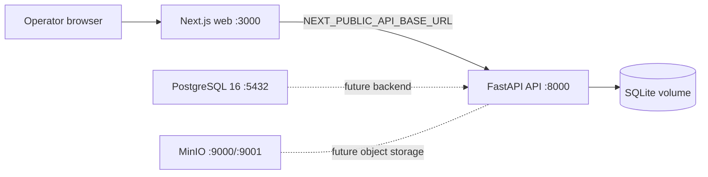
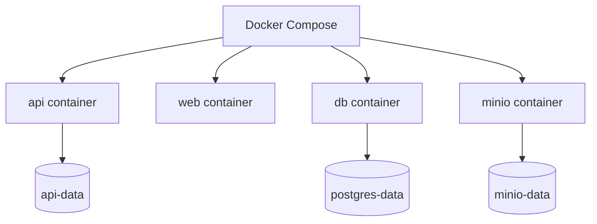

# Architecture and deployment diagrams

## Local architecture

## Local deployment

This diagram describes only local containers. Cloud load balancers, managed PostgreSQL,
Kubernetes, KMS, DNS, and alerting are not implemented.
